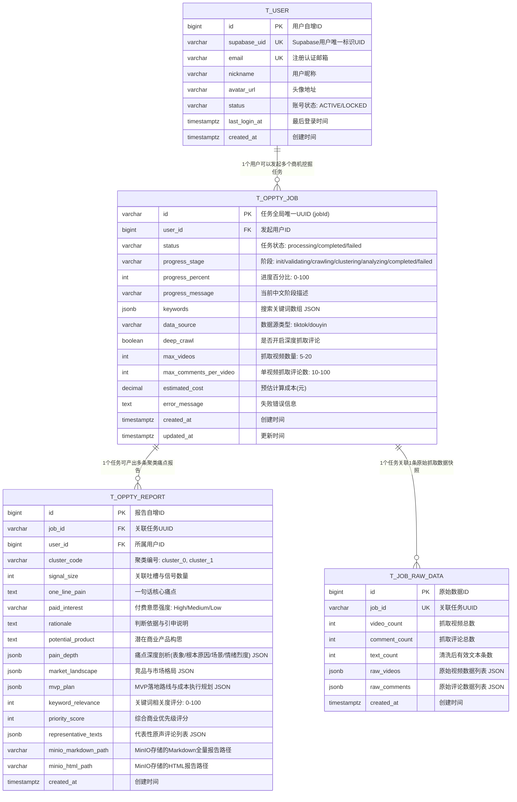

# 数据模型文档 (Data Model)

> **文档版本**：v1.0.1  
> **关联功能**：`docs/02_features.md`  
> **状态**：已基线化 / 增量变更同步完成  
> **数据库引擎**：PostgreSQL 17 (与服务器 `192.168.8.206` 统一，库名：`oppty_discovery`)  
> **工程标识**：`oppty-discovery`

### 版本变更记录 (Revision History)

| 版本号 | 变更日期 | 变更类型（三级决策树） | 变更摘要 | 责任人 |
| :--- | :--- | :--- | :--- | :--- |
| **v1.0.0** | 2026-10-13 | 初始基线 | 初始数据模型基线化，包含用户、任务、报告及原始快照实体与 DDL | reynolds |
| **v1.0.1** | 2026-10-13 | 功能级变更 (A1) & 模块内扩展 (A2) | 1. 明确 TikHub API 响应（`aweme_info`、`comments` 结构）对 `t_job_raw_data` 的映射；<br>2. 补充外部 API 抓取入参及失败兜底标志位定义。 | reynolds |
| **v1.0.8** | 2026-10-15 | 功能级变更 (A1) | 1. 明确 `t_job_raw_data.raw_comments` 与 `t_oppty_report.representative_texts` 均仅收录 TikHub 真实抓取的评论文本；<br>2. 彻底废弃 mock 假数据填充，真实客观记录原始数据状态。 | reynolds |

---

## 1. 实体关系图 (Entity Relationship Diagram)



---

## 2. 数据库 DDL 表结构定义 (PostgreSQL 17)

```sql
-- 创建独立业务数据库 (若不存在)
-- CREATE DATABASE oppty_discovery WITH OWNER postgres ENCODING 'UTF8';

-- 1. 用户档案表: t_user (支持 Supabase OTP 无感自动建档)
CREATE TABLE IF NOT EXISTS t_user (
    id BIGSERIAL PRIMARY KEY,
    supabase_uid VARCHAR(64) NOT NULL UNIQUE,
    email VARCHAR(128) NOT NULL UNIQUE,
    nickname VARCHAR(64) DEFAULT '',
    avatar_url VARCHAR(255) DEFAULT '',
    status VARCHAR(32) NOT NULL DEFAULT 'ACTIVE',
    last_login_at TIMESTAMPTZ DEFAULT CURRENT_TIMESTAMP,
    created_at TIMESTAMPTZ NOT NULL DEFAULT CURRENT_TIMESTAMP,
    updated_at TIMESTAMPTZ NOT NULL DEFAULT CURRENT_TIMESTAMP,
    deleted_at TIMESTAMPTZ DEFAULT NULL
);

CREATE INDEX IF NOT EXISTS idx_user_email ON t_user (email);
CREATE INDEX IF NOT EXISTS idx_user_supabase_uid ON t_user (supabase_uid);

COMMENT ON TABLE t_user IS '用户基础档案表';
COMMENT ON COLUMN t_user.supabase_uid IS 'Supabase 认证体系用户唯一 UUID';
COMMENT ON COLUMN t_user.email IS '注册登录邮箱';
COMMENT ON COLUMN t_user.status IS '账号状态：ACTIVE-正常, LOCKED-已冻结';

-- 2. 商机分析任务表: t_oppty_job
CREATE TABLE IF NOT EXISTS t_oppty_job (
    id VARCHAR(64) PRIMARY KEY,
    user_id BIGINT NOT NULL,
    status VARCHAR(32) NOT NULL DEFAULT 'processing',
    progress_stage VARCHAR(32) NOT NULL DEFAULT 'init',
    progress_percent INT NOT NULL DEFAULT 0,
    progress_message VARCHAR(255) NOT NULL DEFAULT '正在初始化任务...',
    keywords JSONB NOT NULL DEFAULT '[]'::jsonb,
    data_source VARCHAR(32) NOT NULL DEFAULT 'tiktok',
    deep_crawl BOOLEAN NOT NULL DEFAULT TRUE,
    max_videos INT NOT NULL DEFAULT 10,
    max_comments_per_video INT NOT NULL DEFAULT 20,
    estimated_cost NUMERIC(10, 4) NOT NULL DEFAULT 0.0000,
    error_message TEXT DEFAULT '',
    created_at TIMESTAMPTZ NOT NULL DEFAULT CURRENT_TIMESTAMP,
    updated_at TIMESTAMPTZ NOT NULL DEFAULT CURRENT_TIMESTAMP,
    deleted_at TIMESTAMPTZ DEFAULT NULL
);

CREATE INDEX IF NOT EXISTS idx_oppty_job_user_created ON t_oppty_job (user_id, created_at DESC);
CREATE INDEX IF NOT EXISTS idx_oppty_job_status ON t_oppty_job (status);

COMMENT ON TABLE t_oppty_job IS '商机发现异步挖掘任务表';
COMMENT ON COLUMN t_oppty_job.id IS '任务全局唯一标识UUID (与前端 jobId 一致)';
COMMENT ON COLUMN t_oppty_job.status IS '任务主状态：processing-进行中, completed-已完成, failed-失败';
COMMENT ON COLUMN t_oppty_job.progress_stage IS '进度细分阶段：init/validating/crawling/clustering/analyzing/completed/failed';
COMMENT ON COLUMN t_oppty_job.estimated_cost IS '预估消耗成本（元）';

-- 3. 商机聚类报告明细表: t_oppty_report
CREATE TABLE IF NOT EXISTS t_oppty_report (
    id BIGSERIAL PRIMARY KEY,
    job_id VARCHAR(64) NOT NULL,
    user_id BIGINT NOT NULL,
    cluster_code VARCHAR(32) NOT NULL DEFAULT 'cluster_0',
    signal_size INT NOT NULL DEFAULT 0,
    one_line_pain TEXT NOT NULL,
    paid_interest VARCHAR(16) NOT NULL DEFAULT 'Medium',
    rationale TEXT NOT NULL,
    potential_product TEXT NOT NULL,
    pain_depth JSONB NOT NULL DEFAULT '{}'::jsonb,
    market_landscape JSONB NOT NULL DEFAULT '{}'::jsonb,
    mvp_plan JSONB NOT NULL DEFAULT '{}'::jsonb,
    keyword_relevance INT NOT NULL DEFAULT 0,
    priority_score INT NOT NULL DEFAULT 0,
    representative_texts JSONB NOT NULL DEFAULT '[]'::jsonb,
    minio_markdown_path VARCHAR(255) DEFAULT '',
    minio_html_path VARCHAR(255) DEFAULT '',
    created_at TIMESTAMPTZ NOT NULL DEFAULT CURRENT_TIMESTAMP,
    updated_at TIMESTAMPTZ NOT NULL DEFAULT CURRENT_TIMESTAMP,
    deleted_at TIMESTAMPTZ DEFAULT NULL
);

CREATE INDEX IF NOT EXISTS idx_oppty_report_job_id ON t_oppty_report (job_id);
CREATE INDEX IF NOT EXISTS idx_oppty_report_user_id ON t_oppty_report (user_id);

COMMENT ON TABLE t_oppty_report IS '商机深度分析报告明细表';
COMMENT ON COLUMN t_oppty_report.one_line_pain IS '一句话核心痛点精炼';
COMMENT ON COLUMN t_oppty_report.paid_interest IS '付费意愿级别：High, Medium, Low';
COMMENT ON COLUMN t_oppty_report.pain_depth IS '痛点四维剖析 JSON';
COMMENT ON COLUMN t_oppty_report.mvp_plan IS 'MVP执行路线方案 JSON';

-- 4. 原始抓取数据快照表: t_job_raw_data
CREATE TABLE IF NOT EXISTS t_job_raw_data (
    id BIGSERIAL PRIMARY KEY,
    job_id VARCHAR(64) NOT NULL UNIQUE,
    video_count INT NOT NULL DEFAULT 0,
    comment_count INT NOT NULL DEFAULT 0,
    text_count INT NOT NULL DEFAULT 0,
    raw_videos JSONB NOT NULL DEFAULT '[]'::jsonb,
    raw_comments JSONB NOT NULL DEFAULT '[]'::jsonb,
    created_at TIMESTAMPTZ NOT NULL DEFAULT CURRENT_TIMESTAMP
);

CREATE INDEX IF NOT EXISTS idx_job_raw_data_job_id ON t_job_raw_data (job_id);

COMMENT ON TABLE t_job_raw_data IS '任务抓取原始数据与原声评论快照表';
```

---

## 3. Go GORM 实体定义 (`internal/model/`)

### 3.1 用户模型 (`internal/model/user.go`)
```go
package model

import (
    "time"
    "gorm.io/gorm"
)

// User 用户基础数据实体
// desc: 映射 t_user 用户表
// date: 2026-10-13 11:20:00
// @author reynolds
// @since v1.0.0
type User struct {
    ID          uint64         `gorm:"primaryKey;autoIncrement;column:id" json:"id"`
    SupabaseUID string         `gorm:"uniqueIndex:uk_supabase_uid;type:varchar(64);not null;column:supabase_uid" json:"supabaseUid"`
    Email       string         `gorm:"uniqueIndex:uk_email;type:varchar(128);not null;column:email" json:"email"`
    Nickname    string         `gorm:"type:varchar(64);column:nickname" json:"nickname"`
    AvatarURL   string         `gorm:"type:varchar(255);column:avatar_url" json:"avatarUrl"`
    Status      string         `gorm:"type:varchar(32);not null;default:'ACTIVE';column:status" json:"status"`
    LastLoginAt time.Time      `gorm:"column:last_login_at" json:"lastLoginAt"`
    CreatedAt   time.Time      `gorm:"column:created_at" json:"createdAt"`
    UpdatedAt   time.Time      `gorm:"column:updated_at" json:"updatedAt"`
    DeletedAt   gorm.DeletedAt `gorm:"index;column:deleted_at" json:"-"`
}

func (User) TableName() string {
    return "t_user"
}
```

### 3.2 商机任务模型 (`internal/model/oppty_job.go`)
```go
package model

import (
    "time"
    "gorm.io/gorm"
)

// OpptyJob 商机分析任务实体
// desc: 映射 t_oppty_job 任务表
// date: 2026-10-13 11:20:00
// @author reynolds
// @since v1.0.0
type OpptyJob struct {
    ID                  string         `gorm:"primaryKey;type:varchar(64);column:id" json:"id"`
    UserID              uint64         `gorm:"index:idx_user_created;not null;column:user_id" json:"userId"`
    Status              string         `gorm:"index;type:varchar(32);not null;default:'processing';column:status" json:"status"`
    ProgressStage       string         `gorm:"type:varchar(32);not null;default:'init';column:progress_stage" json:"progressStage"`
    ProgressPercent     int            `gorm:"not null;default:0;column:progress_percent" json:"progressPercent"`
    ProgressMessage     string         `gorm:"type:varchar(255);not null;column:progress_message" json:"progressMessage"`
    Keywords            string         `gorm:"type:jsonb;not null;column:keywords" json:"keywords"`
    DataSource          string         `gorm:"type:varchar(32);not null;default:'tiktok';column:data_source" json:"dataSource"`
    DeepCrawl           bool           `gorm:"not null;default:true;column:deep_crawl" json:"deepCrawl"`
    MaxVideos           int            `gorm:"not null;default:10;column:max_videos" json:"maxVideos"`
    MaxCommentsPerVideo int            `gorm:"not null;default:20;column:max_comments_per_video" json:"maxCommentsPerVideo"`
    EstimatedCost       float64        `gorm:"type:decimal(10,4);not null;default:0.0000;column:estimated_cost" json:"estimatedCost"`
    ErrorMessage        string         `gorm:"type:text;column:error_message" json:"errorMessage"`
    CreatedAt           time.Time      `gorm:"index:idx_user_created,sort:desc;column:created_at" json:"createdAt"`
    UpdatedAt           time.Time      `gorm:"column:updated_at" json:"updatedAt"`
    DeletedAt           gorm.DeletedAt `gorm:"index;column:deleted_at" json:"-"`
}

func (OpptyJob) TableName() string {
    return "t_oppty_job"
}
```

### 3.3 商机报告模型 (`internal/model/oppty_report.go`)
```go
package model

import (
    "time"
    "gorm.io/gorm"
)

// OpptyReport 商机报告实体
// desc: 映射 t_oppty_report 表
// date: 2026-10-13 11:20:00
// @author reynolds
// @since v1.0.0
type OpptyReport struct {
    ID                  uint64         `gorm:"primaryKey;autoIncrement;column:id" json:"id"`
    JobID               string         `gorm:"index;type:varchar(64);not null;column:job_id" json:"jobId"`
    UserID              uint64         `gorm:"index;not null;column:user_id" json:"userId"`
    ClusterCode         string         `gorm:"type:varchar(32);not null;column:cluster_code" json:"clusterCode"`
    SignalSize          int            `gorm:"not null;default:0;column:signal_size" json:"signalSize"`
    OneLinePain         string         `gorm:"type:text;not null;column:one_line_pain" json:"oneLinePain"`
    PaidInterest        string         `gorm:"type:varchar(16);not null;default:'Medium';column:paid_interest" json:"paidInterest"`
    Rationale           string         `gorm:"type:text;not null;column:rationale" json:"rationale"`
    PotentialProduct    string         `gorm:"type:text;not null;column:potential_product" json:"potentialProduct"`
    PainDepth           string         `gorm:"type:jsonb;not null;column:pain_depth" json:"painDepth"`
    MarketLandscape     string         `gorm:"type:jsonb;not null;column:market_landscape" json:"marketLandscape"`
    MVPPlan             string         `gorm:"type:jsonb;not null;column:mvp_plan" json:"mvpPlan"`
    KeywordRelevance    int            `gorm:"not null;default:0;column:keyword_relevance" json:"keywordRelevance"`
    PriorityScore       int            `gorm:"not null;default:0;column:priority_score" json:"priorityScore"`
    RepresentativeTexts string         `gorm:"type:jsonb;not null;column:representative_texts" json:"representativeTexts"`
    MinioMarkdownPath   string         `gorm:"type:varchar(255);column:minio_markdown_path" json:"minioMarkdownPath"`
    MinioHTMLPath       string         `gorm:"type:varchar(255);column:minio_html_path" json:"minioHtmlPath"`
    CreatedAt           time.Time      `gorm:"column:created_at" json:"createdAt"`
    UpdatedAt           time.Time      `gorm:"column:updated_at" json:"updatedAt"`
    DeletedAt           gorm.DeletedAt `gorm:"index;column:deleted_at" json:"-"`
}

func (OpptyReport) TableName() string {
    return "t_oppty_report"
}
```

---

## 4. 枚举与字典注册表 (`internal/types/enums.go`)

```go
package types

// DataSourceType 数据源类型枚举
type DataSourceType string

const (
    DataSourceTikTok  DataSourceType = "tiktok"  // TikTok 国际版
    DataSourceDouyin  DataSourceType = "douyin"  // 抖音短视频
)

// Desc 获取数据源中文名
func (d DataSourceType) Desc() string {
    switch d {
    case DataSourceTikTok:
        return "TikTok 国际版"
    case DataSourceDouyin:
        return "抖音短视频"
    default:
        return "未知数据源"
    }
}

// JobStatus 任务执行主状态枚举
type JobStatus string

const (
    JobStatusProcessing JobStatus = "processing" // 进行中
    JobStatusCompleted  JobStatus = "completed"  // 分析完成
    JobStatusFailed     JobStatus = "failed"     // 执行失败
)

// ProgressStage 任务执行精细化阶段枚举
type ProgressStage string

const (
    StageInit       ProgressStage = "init"       // 初始化阶段
    StageValidating ProgressStage = "validating" // 参数校验中
    StageCrawling   ProgressStage = "crawling"   // 抓取评论与视频中
    StageClustering ProgressStage = "clustering" // 语义密度聚类分析中
    StageAnalyzing  ProgressStage = "analyzing"  // 大模型深度商业洞察提炼中
    StageCompleted  ProgressStage = "completed"  // 全部完成
    StageFailed     ProgressStage = "failed"     // 执行异常中断
)

// PaidInterestType 付费意愿强烈等级
type PaidInterestType string

const (
    PaidInterestHigh   PaidInterestType = "High"   // 高付费意愿
    PaidInterestMedium PaidInterestType = "Medium" // 中等付费意愿
    PaidInterestLow    PaidInterestType = "Low"    // 低付费意愿
)
```

---

## 5. 前端 TypeScript 类型定义映射 (`oppty-discovery-frontend/src/types/`)

```typescript
/**
 * 数据源类型
 */
export type DataSourceType = 'tiktok' | 'douyin';

/**
 * 任务主状态
 */
export type JobStatusType = 'processing' | 'completed' | 'failed';

/**
 * 任务流转细分阶段
 */
export type ProgressStageType = 
  | 'init' 
  | 'validating' 
  | 'crawling' 
  | 'clustering' 
  | 'analyzing' 
  | 'completed' 
  | 'failed';

/**
 * 痛点深度剖析
 */
export interface PainDepth {
  surface_pain: string;
  root_causes: string[];
  user_scenarios: string[];
  emotional_intensity: number;
}

/**
 * 竞品与市场格局
 */
export interface MarketLandscape {
  existing_solutions: Array<{
    name: string;
    limitation: string;
  }>;
  unmet_needs: string[];
  opportunity: string;
}

/**
 * MVP落地执行方案
 */
export interface MVPPlan {
  core_features: string[];
  validation_hypotheses: Array<{
    hypothesis: string;
    test_method: string;
  }>;
  first_users: string;
  timeline: string;
  estimated_cost: string;
}

/**
 * 单条商机聚类报告视图对象 (VO)
 */
export interface OpptyReportVO {
  id: string;
  clusterCode: string;
  signalSize: number;
  oneLinePain: string;
  paidInterest: 'High' | 'Medium' | 'Low';
  rationale: string;
  potentialProduct: string;
  painDepth: PainDepth;
  marketLandscape: MarketLandscape;
  mvpPlan: MVPPlan;
  keywordRelevance: number;
  priorityScore: number;
  representativeTexts: string[];
  minioMarkdownUrl?: string;
  minioHtmlUrl?: string;
}

/**
 * 任务详情与报告综合视图 (VO)
 */
export interface OpptyJobDetailVO {
  jobId: string;
  status: JobStatusType;
  progressStage: ProgressStageType;
  progressPercent: number;
  progressMessage: string;
  keywords: string[];
  dataSource: DataSourceType;
  deepCrawl: boolean;
  maxVideos: number;
  maxCommentsPerVideo: number;
  estimatedCost: number;
  results: OpptyReportVO[];
  errorMessage?: string;
  createdAt: string;
}

/**
 * 商机历史记录摘要项 (VO)
 */
export interface OpptyHistoryItemVO {
  jobId: string;
  keywords: string[];
  dataSource: DataSourceType;
  signalCount: number;
  reportCount: number;
  primaryPain: string;
  status: JobStatusType;
  estimatedCost: number;
  createdAt: string;
}
```
